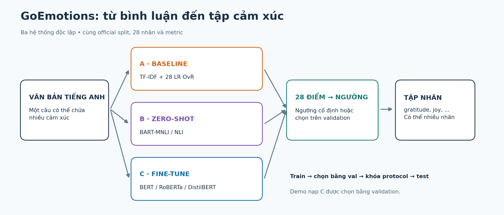
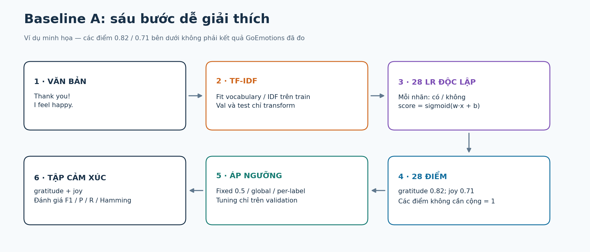
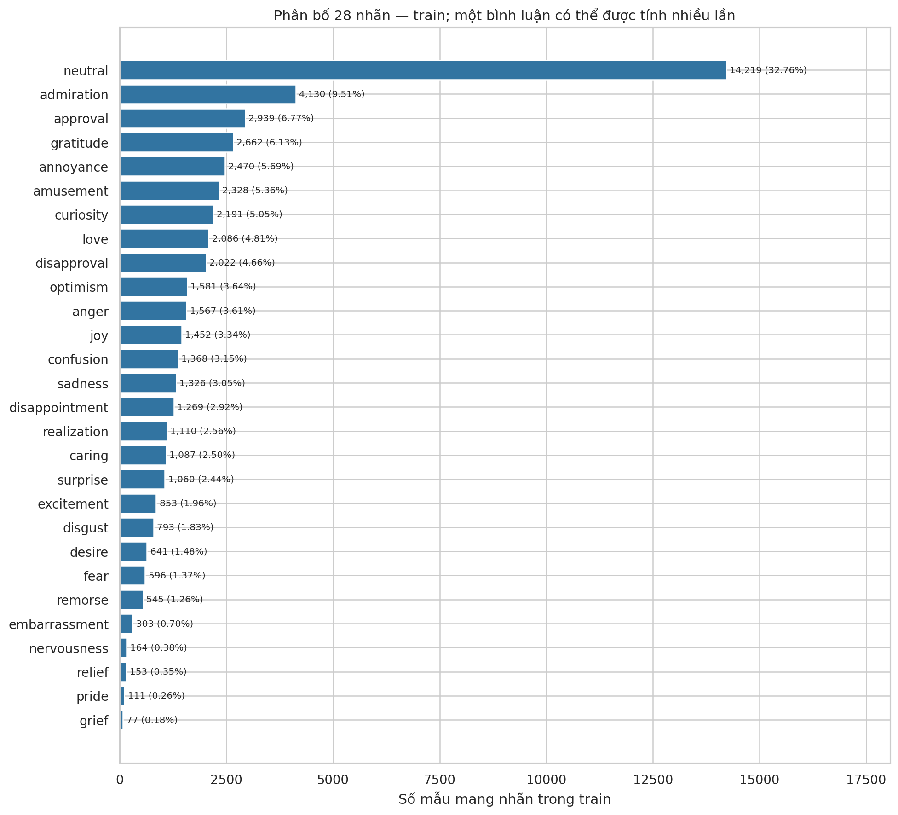
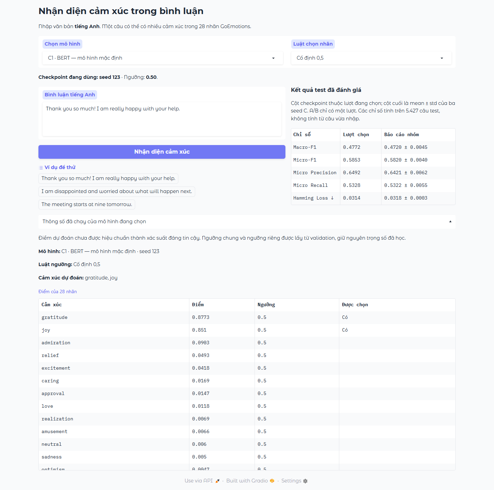

# GoEmotions · Multi-label Emotion Classification

**Một bình luận. Nhiều cảm xúc. Một quy trình thực nghiệm có thể kiểm lại.**


[Chạy thử](#quick-start) · [Baseline của Duy](#baseline) · [Notebook](#notebooks) · [Thực nghiệm](#experiments) · [Demo](#demo) · [Đọc code](#code-map)

**Xem kết quả ngay trên GitHub:** mở [bộ notebook đã chạy có output](notebooks/executed/).
Source để chỉnh sửa nằm trực tiếp trong `notebooks/`; bản đã chạy nằm trong
`notebooks/executed/`, có manifest kiểm hash và xác nhận mọi code cell đã thực thi.
Notebook đọc bộ artifacts cục bộ đã kiểm: A/C suy luận thật từ checkpoint;
B tính lại metric từ scores NLI đã lưu. Manifest ghi rõ lần chạy từng notebook.

## Kết quả hiện tại để làm báo cáo và slide

Bộ chạy full hoàn tất ngày **25/10/2026 trên máy Nhật Huy**, dùng cho báo cáo cập nhật
26/10/2026. Đây là bộ số liệu hiện tại; `results/report_2_1/` là bản lịch sử.

| Cần xem | Đường dẫn |
|---|---|
| Bảng tổng hợp A/B/C và mean ± std | [reports/project_results/mean_std.csv](reports/project_results/mean_std.csv) |
| Kết quả từng seed và từng ngưỡng | [all_runs.csv](reports/project_results/all_runs.csv) |
| F1 từng nhãn và cải thiện nhãn hiếm | [per_label.csv](reports/project_results/per_label.csv), [rare_before_after.csv](reports/project_results/rare_before_after.csv) |
| Log từng epoch, train loss, validation F1 | [learning_curves.csv](reports/project_results/learning_curves.csv), các `run_metadata.json` trong [bộ kết quả huấn luyện](results/training_20261025/data/processed/transformers/) |
| Biểu đồ thực nghiệm | [reports/project_results/figures/](reports/project_results/figures/) |
| EDA và biểu đồ dữ liệu | [reports/tables/](reports/tables/), [reports/figures/](reports/figures/) |
| Phân tích lỗi, ví dụ thật | [reports/errors_test_standard_fixed/](reports/errors_test_standard_fixed/) |
| Kiểm lại số liệu báo cáo | [reports/reproduction_report_20261026/](reports/reproduction_report_20261026/) |
| Minh chứng demo sáu lựa chọn | [kiểm suy luận](reports/demo_all_models_verification.json), [kiểm HTTP/API](reports/demo_http_verification.json) |
| Scores validation/test, ngưỡng và cấu hình đã lưu | [results/training_20261025/](results/training_20261025/) |
| Notebook có sẵn output | [notebooks/executed/](notebooks/executed/) |

**Không cần huấn luyện lại để đọc các bảng và notebook trên.** Bộ huấn luyện lưu đủ
cấu hình, môi trường, log epoch và scores cho chín run C (3 kiến trúc × 3 seed), hai
baseline A và B zero-shot. B chỉ suy luận, không có epoch fine-tune. Mỗi bản sao
có SHA-256 trong [manifest](results/training_20261025/manifest.json).

### Tải checkpoint để chạy demo hoặc suy luận

Trọng số của cả **9 checkpoint C và 2 mô hình A** nằm trong
[Releases của chính repo](https://github.com/trangkhanh-ai/goemotions-multilabel-classification/releases/tag/goemotions-full-20261025).
[Danh sách ZIP, dung lượng và SHA-256](results/training_20261025/checkpoint_assets.json)
cho phép kiểm tra file đã tải. Các ZIP giữ đường dẫn `data/processed/...`.

1. Clone repo và cài thư viện theo phần setup bên dưới.
2. Chép nội dung `results/training_20261025/data/` vào `data/` của bản clone.
3. Tải và giải nén các ZIP checkpoint tại gốc repo. Muốn đủ cả ba kiến trúc × ba seed,
   tải đủ chín ZIP C và `baseline_models.zip`. Muốn chỉ chạy demo, dùng seed đại diện
   BERT 123, RoBERTa 2026, DistilBERT 123 cùng baseline.
4. Tải dữ liệu bằng lệnh trong README nếu cần chạy lại đánh giá. BART-MNLI được nạp
   từ Hugging Face theo revision trong metadata khi chọn zero-shot lần đầu.
5. Chạy `python app.py --device auto --c3-source benchmark`.

Giải nén checkpoint và chạy demo không huấn luyện lại mô hình. Các file trọng số lớn
được phát hành dưới dạng release assets, không nằm trong lịch sử Git. Bộ minh chứng
demo hiện xác nhận HTTP/API; chưa thay thế kiểm tra trực quan giao diện trình duyệt.

## Hoàn tất mô hình và chạy demo trên máy hiện tại

Chạy từ gốc repo bằng môi trường đã cài đủ thư viện. Trên máy Huy:

```powershell
$py = ".venv-huy/Scripts/python.exe"
$env:PYTHONUTF8 = "1"
$env:HF_HOME = "$PWD/data/cache/huggingface"
& $py -m scripts.baseline.run_baseline
& $py -m scripts.baseline.run_baseline --variant balanced
& $py -m scripts.baseline.analyze_baseline
& $py -m scripts.pipeline.complete_project --device cuda
& $py -m scripts.verification.reproduce_report --artifacts-root .
& $py -m scripts.data.run_notebooks --notebook all --publish --artifacts-root .
& $py -m scripts.transformers.verify_demo --device cuda
& $py -m scripts.verification.verify_model_selector --device cuda
& $py app.py --device cuda --c3-source benchmark
```

Chỉ chạy các lệnh train A khi chưa có model cần giữ. Pipeline C tự kiểm và bỏ qua
run full đã hoàn thành; không dùng `--overwrite` cho checkpoint muốn bảo toàn.
Run dở cần kiểm log trước khi quyết định chạy lại. Mỗi thời điểm chạy một tác vụ GPU.

Pipeline tạo hai A, BART-MNLI zero-shot và ba kiến trúc C × ba seed 42/123/2026.
Checkpoint/ngưỡng chọn bằng validation rồi khóa trước test. Số mới nằm trong
`reports/project_results/`, model và scores trong `data/processed/`.
Notebook 04/05 dùng cùng bộ chín checkpoint này. Không chuyển số từ snapshot
`results/report_2_1/` thành kết quả của máy hiện tại.

Demo mở tại `http://127.0.0.1:7860`. Kiến trúc mặc định lấy từ
`selected_model.json`, không cố định BERT hoặc seed 123. Có sáu lựa chọn:
hai baseline A, zero-shot B và ba kiến trúc C. Lệnh kiểm toàn bộ lựa chọn ghi
`reports/demo_all_models_verification.json`; kiểm hàm suy luận không thay cho
minh chứng giao diện trình duyệt. Các lượt chạy mới không bảo đảm trùng điểm cũ.

## Snapshot báo cáo 2.1 đã công bố trước lượt chạy cục bộ

**Đã fine-tune ba C, chưa có bằng chứng đã tìm được cấu hình tốt nhất.**
Mỗi kiến trúc chạy một cấu hình với ba seed 42/123/2026. Đây là kiểm độ ổn định,
chưa phải tìm learning rate, epoch hoặc batch size. Cả 9 run đều chọn epoch cuối
(BERT 4, RoBERTa/DistilBERT 3); nên thử thêm trên validation trước khi kết luận đã hội tụ.
Không suy ra chắc chắn thêm epoch sẽ tốt hơn.

Số **test**, ba C là mean ± sample std của ba seed; ngưỡng riêng đã khóa từ validation:

| Hệ thống | Macro-F1 | Micro-F1 |
|---|---:|---:|
| A balanced, tuned | 0.4493 | 0.5277 |
| B BART-MNLI, tuned | 0.1609 | 0.1752 |
| C1 BERT, tuned | 0.5038 ± 0.0097 | 0.5900 ± 0.0029 |
| C2 RoBERTa, tuned | 0.4872 ± 0.0156 | 0.6048 ± 0.0057 |
| C3 DistilBERT, tuned | 0.4863 ± 0.0065 | 0.5952 ± 0.0046 |

BERT thắng theo Macro-F1; RoBERTa có Micro-F1 tuned cao hơn.
Demo vẫn dùng **BERT seed 123**, đã chọn trước bằng **validation Macro-F1 @0.5**,
không đổi người thắng theo test. B không fine-tune; A chưa tìm C/ngram tốt nhất.
Chỉnh ngưỡng không đồng nghĩa với fine-tune trọng số. C3 dùng ba seed 42/123/2026 theo thiết kế của Huy; mọi bảng và biểu đồ lấy cùng một bộ kết quả đã kiểm.

### C3 DistilBERT theo thiết kế của Nhật Huy

Fine-tune từ pretrained, đủ **43.410 train / 5.426 validation**,
ba seed 42/123/2026, 3 epoch, batch 16, LR 2e-5, max length 128, AMP FP16 và
gradient checkpointing. Môi trường: **Python 3.13.9,
PyTorch 2.13.0+cu130, Transformers 4.57.6**. Chọn checkpoint và ngưỡng bằng
validation; khóa đủ ba protocol trước khi suy luận **5.427 test**.

| Ngưỡng C3 trên test | Macro-F1 | Micro-F1 |
|---|---:|---:|
| Fixed 0.5 | 0.4134 ± 0.0021 | 0.5742 ± 0.0005 |
| Từng nhãn chọn trên validation | 0.4863 ± 0.0065 | 0.5952 ± 0.0046 |

Từ thư mục code, dùng môi trường hiện có:

```powershell
$py = "../goemotions-multilabel-classification/.venv-models/Scripts/python.exe"
& $py -m scripts.distilbert.reproduce_c3 --output reports/c3_current_environment_2026-10-21
& $py -m scripts.distilbert.export_c3_report_data --run-root reports/c3_current_environment_2026-10-21 --historical-root ../goemotions-multilabel-classification
& $py -m scripts.distilbert.plot_c3_report --data reports/c3_current_environment_2026-10-21/report_data
```

Muốn huấn luyện một bộ mới, dùng đường dẫn output mới. Output đã hoàn tất chỉ được
tái sử dụng sau khi kiểm config, nguồn, dataset, checkpoint và hash. Runner từ chối
ghi đè lượt dở; không tự tiếp tục optimizer từ giữa epoch. Mỗi seed có `run.json`,
`history.json`, `best/`, scores, ngưỡng, `final_protocol.json` và `test_results.json`.
`report_data/` có **72 bản ghi / 36 nhóm**, nhãn hiếm, các cặp lỗi và ba ví dụ cùng ID.
`historical_verification/` giữ bằng chứng kiểm A/B/C1/C2; không gọi đây là train mới.

Kiểm trực tiếp bản Word mới:

```powershell
& $py -m scripts.verification.verify_current_c3_report --run-root reports/c3_current_environment_2026-10-21 --report "đường-dẫn-bản-Word-đã-cập-nhật.docx"
```

Các lệnh trong mục C3 phía trên dành riêng cho bộ báo cáo 2.1. Notebook 04/05
hiện dùng C3 trong pipeline chung; giữ riêng snapshot và bundle lịch sử.

### Tính lại bộ benchmark lịch sử từ artifacts hiện có

Trong workspace này, code chính nằm ở `goemotions-source-only`; dataset/checkpoint/
scores lịch sử nằm ở thư mục cạnh nó `goemotions-multilabel-classification`.
Chạy từ thư mục code bằng Python đã có đủ thư viện:

```powershell
$py = "../goemotions-multilabel-classification/.venv-models/Scripts/python.exe"
& $py -m scripts.verification.reproduce_report --artifacts-root ../goemotions-multilabel-classification
```

Lệnh kiểm hash dataset/model/protocol, ghép scores theo ID, áp đúng ngưỡng đã khóa,
tính lại **72 dòng và 36 nhóm**, so toàn bộ 7 metric với CSV gốc ở sai số ≤ 1e-12.
Thiếu/sai dữ liệu sẽ dừng; không tải mạng, không tự tìm ngưỡng mới.
Kết quả kiểm ở `reports/reproduction/verification.json`; CSV tính lại nằm cùng thư mục.

Muốn **suy luận test thật lại** từ hai model A và cả 9 checkpoint C, thêm:

```powershell
& $py -m scripts.verification.reproduce_report --artifacts-root ../goemotions-multilabel-classification --inference-baseline --inference-c --device cuda
```

Với bản Word dùng đúng bộ C3 lịch sử, có thể thêm `--report <đường-dẫn-báo-cáo-cuối-kỳ.docx>` để đối chiếu trực tiếp
111 ô metric trong 9 bảng kết quả Word. Output luôn tách khỏi artifacts gốc.
Lượt kiểm 20/10/2026 đã chạy cả hai A và chín C: scores/metric trùng bản cũ,
sai lệch lớn nhất bằng **0** trên cùng máy. B được tính lại từ scores NLI đã lưu;
hai lệnh trên không chạy lại suy luận B. Nghiên cứu C3 riêng của Huy thiếu bundle
checkpoint tại workspace này nên chưa suy luận lại được; không ảnh hưởng C3 chung.

Đây là tái lập metric/suy luận, **không phải huấn luyện lại** từ pretrained.
Huấn luyện lại cần cùng revision, seed, dependency và GPU; không bảo đảm giống bit
trên mọi máy. Muốn cải tiến mô hình, dùng thí nghiệm mới và validation; giữ bộ số
đã báo cáo cùng protocol cũ để đối chiếu.



## Đồ án làm gì?

Phân loại cảm xúc đa nhãn trong bình luận Reddit **tiếng Anh** bằng GoEmotions:
**27 cảm xúc + neutral**. Một câu có thể vừa cảm ơn, vừa vui hoặc lo lắng.
Mô hình trả 28 điểm; ngưỡng quyết định tập nhãn được chọn.

| Phần | Phương pháp | Vai trò |
|---|---|---|
| **A · Baseline** | TF-IDF + One-vs-Rest Logistic Regression | Mốc cổ điển; class weighting và threshold tuning |
| **B · Zero-shot** | BART-large-MNLI qua NLI | Dùng pretrained trực tiếp, không fine-tune bằng GoEmotions |
| **C · Fine-tune** | BERT / RoBERTa / DistilBERT | 28 logits + BCE, ba seed mỗi kiến trúc |
| **D · Demo** | Gradio | Mặc định C chọn bằng validation; cho phép thử A, B và ba C |

A/B/C chạy độc lập, cùng dữ liệu/mapping/metric. A là mốc so sánh,
không phải đầu vào bắt buộc của Transformer.

<a id="quick-start"></a>
## 1. Chạy thử nhanh trên CPU

Cần **Python 3.12 hoặc 3.13**. Chạy lệnh từ thư mục có `pyproject.toml`.

```bash
git clone https://github.com/trangkhanh-ai/goemotions-multilabel-classification.git
cd goemotions-multilabel-classification
python -m venv .venv
```

| Hệ điều hành | Kích hoạt |
|---|---|
| PowerShell | `./.venv/Scripts/Activate.ps1` |
| Windows CMD | `.venv\Scripts\activate.bat` |
| Linux/macOS | `source .venv/bin/activate` |

```bash
python -m pip install -e .
python -m examples.baseline_from_scratch
```

Ví dụ NumPy in vocabulary, IDF, TF-IDF, loss và nhãn dự đoán.
**Dữ liệu tự tạo; không tải model/dataset, không dùng điểm này làm benchmark.**

Chạy notebook với pipeline scikit-learn và metric của baseline thật:

```bash
python -m pip install -e ".[notebooks]"
python -m scripts.data.run_notebooks --notebook 00_quick_start
```

Đọc [00_quick_start.ipynb](notebooks/00_quick_start.ipynb).
Bản có output được lưu cục bộ ở `reports/notebooks/00_quick_start.executed.ipynb`.

<a id="setup"></a>
## 2. Cài đúng phần cần dùng

| Nhu cầu | Lệnh |
|---|---|
| Baseline CPU | `python -m pip install -e .` |
| EDA + Jupyter | `python -m pip install -e ".[eda,notebooks]"` |
| B, ba C và Gradio | Cài PyTorch phù hợp, rồi `python -m pip install -e ".[transformers]"` |
| Đầy đủ | Cài PyTorch phù hợp, rồi `python -m pip install -e ".[eda,notebooks,transformers,dev]"` |
| Nghiên cứu C3 riêng | `python -m pip install -e ".[study,eda,notebooks]"` |

CPU: cài wheel CPU trước extra Transformer:

```bash
python -m pip install torch --index-url https://download.pytorch.org/whl/cpu
python -m pip install -e ".[transformers]"
```

NVIDIA: chọn wheel đúng GPU/driver tại [PyTorch](https://pytorch.org/get-started/locally/).
Kiểm đang dùng đúng Python và CUDA:

```bash
python -c "import sys; print(sys.executable)"
python -c "import torch; print(torch.__version__); print(torch.cuda.is_available())"
```

[requirements/](requirements/) chia dependency theo phần;
[models-lock.txt](requirements/models-lock.txt) ghi môi trường nghiên cứu trước.
Wheel CPU/CUDA vẫn cần phù hợp máy. Nếu PowerShell chặn kích hoạt, dùng trực tiếp
`./.venv/Scripts/python.exe` thay cho `python`.

<a id="baseline"></a>
## 3. Baseline A — phần của Duy



Điểm trong sơ đồ là **minh họa**, không phải số GoEmotions đã đo.

1. **TF-IDF:** fit vocabulary/IDF chỉ trên train; val/test chỉ transform.
2. **OvR:** mỗi nhãn có một LR nhị phân riêng, tổng cộng 28 LR.
3. **Score:** `sigmoid(w_j · x + b_j)`; 28 điểm không cần cộng thành 1.
4. **Ngưỡng:** chọn mọi nhãn vượt ngưỡng, không dùng argmax ép một nhãn.
5. **Metric:** so tập nhãn với multi-hot thật bằng module chung.

TF-IDF: unigram/bigram, `min_df=2`, `max_features=100000`.
LR: `C=1`, `solver="liblinear"`, `max_iter=1000`, `random_state=42`.
Standard dùng trọng số mặc định; balanced dùng `class_weight="balanced"`
cho mỗi bài toán nhị phân, tính từ train.

### Train → analyze → predict

```bash
python -m scripts.baseline.run_baseline
python -m scripts.baseline.run_baseline --variant balanced
python -m scripts.baseline.analyze_baseline
python -m scripts.baseline.predict_baseline --variant balanced --threshold tuned --text "Thank you, but I am still worried."
```

Lần đầu tải snapshot train/validation và kiểm SHA-256.
Hai lần train tạo hai model độc lập; analyze cần cả hai bản **full**.
Predictor nạp model balanced và ngưỡng đúng model đó.

| `--threshold` | Luật quyết định |
|---|---|
| `fixed` | 0,5 cho mọi nhãn |
| `global` | Một ngưỡng chung chọn bằng Macro-F1 validation |
| `tuned` | Một ngưỡng mỗi nhãn chọn bằng F1 validation của nhãn đó |

Lưới 0,05–0,95, bước 0,05; hòa chọn gần 0,5 rồi ngưỡng lớn hơn.
Không chuyển ngưỡng standard sang balanced.

### Khóa cấu hình trước test

Sau khi đã chốt lựa chọn bằng validation:

```bash
python -m scripts.baseline.freeze_baseline
python -m scripts.baseline.evaluate_baseline_test
```

Tuned-validation dùng chính tập chọn ngưỡng, có thể lạc quan.
Test giữ model/ngưỡng đã khóa, không dùng test chọn lại.
Weighting/tuning có thể đổi P/R/Hamming theo nhiều chiều; báo cả nhãn giảm F1.
So standard fixed với balanced tuned thay cả weighting và ngưỡng, chưa cô lập từng kỹ thuật.

Kiểm luồng nhỏ: `python -m scripts.baseline.run_baseline --smoke`.
Smoke dùng 5.000 train/1.000 val, lưu riêng, không thay model full hoặc benchmark.

<a id="notebooks"></a>
## 4. Notebook: đọc và chạy theo thứ tự

| Source để chỉnh | Bản đã chạy, có output | Phạm vi của kết quả |
|---|---|---|
| [00 · Chạy thử](notebooks/00_quick_start.ipynb) | [Mở kết quả 00](notebooks/executed/00_quick_start.executed.ipynb) | Fit/predict trên dữ liệu minh họa; không dùng làm benchmark |
| [01 · EDA](notebooks/01_eda.ipynb) | [Mở kết quả 01](notebooks/executed/01_eda.executed.ipynb) | Tính mới thống kê/biểu đồ trên official snapshot |
| [02 · Baseline](notebooks/02_baseline.ipynb) | [Mở kết quả 02](notebooks/executed/02_baseline.executed.ipynb) | Đọc model đã fit, suy luận test mới cả hai A, kiểm sáu cấu hình |
| [03 · Zero-shot](notebooks/03_zero_shot.ipynb) | [Mở kết quả 03](notebooks/executed/03_zero_shot.executed.ipynb) | Tính lại sáu dòng validation/test từ scores NLI đã lưu; không chạy mới BART |
| [04 · Transformers](notebooks/04_transformers.ipynb) | [Mở kết quả 04](notebooks/executed/04_transformers.executed.ipynb) | Hồ sơ C1/C2/C3; BCE forward; suy luận test đủ chín checkpoint của pipeline cục bộ |
| [05 · DistilBERT Huy](notebooks/05_distilbert_huy.ipynb) | [Mở kết quả 05](notebooks/executed/05_distilbert_huy.executed.ipynb) | Ba lượt full C3; suy luận validation/test, kiểm metric, ngưỡng, nhãn hiếm, lỗi và dự đoán |
| [06 · EDA bổ sung](notebooks/06_eda_extra.ipynb) | [Mở kết quả 06](notebooks/executed/06_eda_extra.executed.ipynb) | EDA độc lập; tokenizer ghim revision; đồng xuất hiện dùng int64 tránh tràn uint8 |

Mở Jupyter từ gốc repo: `python -m jupyterlab`, chọn kernel của `.venv`.
Hoặc chạy notebook 02 bằng Python hiện tại, sau bước train/analyze A:

```bash
python -m scripts.data.run_notebooks --notebook 02_baseline
```

Runner mặc định giữ source sạch, ghi output vào `reports/notebooks/`.
Để chạy toàn bộ và cập nhật bản có output dùng nộp/bảo vệ:

```powershell
& $py -m scripts.data.run_notebooks --notebook all --publish --artifacts-root ../goemotions-multilabel-classification
```

`$py` được khai báo ở phần tái lập đầu README. Trên máy khác dùng Python của môi
trường đã cài đủ extra `eda,notebooks,transformers` và trỏ `--artifacts-root` đến
thư mục có `data/` và `reports/` của các run đã báo cáo. Nếu mở Jupyter trực tiếp,
có thể đặt biến môi trường `GOEMOTIONS_ARTIFACTS_ROOT`; notebook tự tìm thư mục
code bằng các thư mục cha, kể cả khi mở bản trong `notebooks/executed/`.

Bản notebook công bố dùng checkpoint đối chiếu với bảng `reports/project_results/` của cùng lượt chạy. Manifest ghi thời điểm thực thi cell riêng với thời điểm huấn luyện.
**Run All không huấn luyện lại các mô hình benchmark từ pretrained.** Code train
và log từng epoch được trình bày; các cell đánh giá A/C gọi model thật trên 5.427
mẫu test và kiểm với bộ số báo cáo. Không tìm ngưỡng hoặc chọn lại model bằng test.

[Manifest thực thi](notebooks/executed/execution_manifest.json) gắn source với bản
có output bằng SHA-256 chuẩn hóa LF, số code cell và thời gian chạy UTC. CI kiểm
mọi source có bản chạy, cell thực thi tuần tự, không có error output và không lệch
source. Clone mới xem được output ngay; muốn Run All lại cần dataset/artifacts,
weights lớn không được nhúng vào Git.

Notebook 04/05 cần bộ model/score/protocol do pipeline chung tạo, gồm C3 tại
`data/processed/transformers/distilbert/seed_*/full/standard/`. Thiếu bộ nào sẽ dừng,
không thay bằng checkpoint C3 riêng. [Bảng số liệu và hình của báo cáo 2.1](results/report_2_1/)
vẫn được giữ làm snapshot lịch sử; trọng số lớn nằm trong bộ bàn giao cục bộ.

<a id="data"></a>
## 5. Dữ liệu và đánh giá chung

| Hạng mục | Quy ước |
|---|---|
| Dataset | GoEmotions `simplified`, Reddit tiếng Anh |
| Revision | `add492243ff905527e67aeb8b80c082af02207c3` |
| Official split | **43.410 train / 5.426 val / 5.427 test** |
| Nhãn | [data/labels.json](data/labels.json), 28 vị trí |
| Nhãn thật | Multi-hot `N × 28` |
| Scores | `ids`, `scores` N×28, `label_names`; căn theo ID |
| Metric | Macro/Micro-F1, Precision/Recall, Hamming; per-label P/R/F1/support |

<details>
<summary>Phân bố nhãn thật trên train</summary>



Ảnh EDA đã tạo từ snapshot train cố định; không phải lỗi dự đoán.
Nhãn hiếm chọn từ train: grief 77, pride 111, relief 153, nervousness 164, embarrassment 303.
Code tạo: [build_eda.py](tools/notebooks/build_eda.py).

</details>

Giữ neutral theo annotation, không tự gán neutral khi không điểm nào vượt ngưỡng.
Không âm thầm chia lại/xóa mẫu khỏi official split. EDA kiểm trùng văn bản/ID
và giới hạn dữ liệu. Tiếng Việt/dữ liệu doanh nghiệp cần đánh giá riêng.

<a id="zero-shot"></a>
## 6. Zero-shot B

Cài extra Transformer trước. Smoke kiểm luồng; full tạo kết quả thực nghiệm:

```bash
python -m scripts.zero_shot.run_zero_shot --smoke --device cpu --dtype float32
python -m scripts.zero_shot.run_zero_shot --device cuda --dtype float16 --batch-size 16
```

CPU dùng `--device cpu --dtype float32`; full cần nhiều phép suy luận.
BART-MNLI giữ nguyên trọng số, đặt từng cảm xúc vào giả thuyết NLI, dùng đủ 28 nhãn.
HF sắp output theo score; code căn về mapping chuẩn. Neutral NLI khác neutral GoEmotions.
Nếu dùng nhãn val để chọn ngưỡng, ghi riêng hàng có hiệu chỉnh bằng nhãn đích.
NLI score chưa mặc nhiên là xác suất cảm xúc đã hiệu chuẩn.

<a id="experiments"></a>
## 7. Ba Transformer và thực nghiệm full

| Kiến trúc | Checkpoint | LR | Epoch tối đa |
|---|---|---:|---:|
| BERT | `google-bert/bert-base-cased` | 5e-5 | 4 |
| RoBERTa | `FacebookAI/roberta-base` | 2e-5 | 3 |
| DistilBERT | `distilbert/distilbert-base-uncased` | 2e-5 | 3 |

Batch 16, max length 128, accumulation 1; seed **42, 123, 2026**.
28 logits đi trực tiếp vào `BCEWithLogitsLoss`; sigmoid khi suy luận.
Checkpoint mỗi seed chọn Macro-F1 validation @0,5.
BERT tham khảo GoEmotions; C2/C3 là cấu hình nhóm. Ba seed đo biến động,
không chứng minh đã tối ưu LR. Khác LR/epoch/tokenizer là giới hạn so kiến trúc.

```bash
# Smoke tải checkpoint, chạy ít mẫu; không tạo benchmark full.
python -m scripts.transformers.train_transformer --architecture distilbert --seed 42 --smoke --device cpu
# Full: ba kiến trúc x ba seed, chạy tuần tự.
python -m scripts.transformers.run_transformer_seeds --device cuda --resume
```

Sau khi **hai baseline full + analyze A đã xong**, có thể chạy pipeline chung:

```bash
python -m scripts.pipeline.complete_project --device cuda
```

Pipeline: ba C × ba seed → B val → chọn C bằng val → khóa A/B/C → test → CSV/JSON,
metadata và nhóm lỗi. CPU đổi thành `--device cpu`; tốc độ tùy máy.
Đã có đủ run full/hash hợp lệ thì dùng `--skip-training`.
`--resume` bỏ qua run hoàn tất đã kiểm, không phục hồi optimizer của run dở.
Không chạy `--overwrite` lên run cần giữ. Một tác vụ GPU tại một thời điểm.

**Đọc kết quả đúng:** C có từng seed và mean ± sample std (`ddof=1`, n=3);
A/B n=1 không tự tạo std. Chọn C bằng mean val Macro-F1 @0,5, không chọn lại bằng test.
Ngưỡng gắn đúng model/revision/seed. Báo nhãn tăng/giảm, support, lỗi có ID.
Cặp FN/FP khác đồng xuất hiện nhãn thật; điểm toy/smoke không thay benchmark.

<a id="demo"></a>
## 8. Demo D — một câu có thể nhiều cảm xúc



Ảnh giao diện cập nhật ngày **22/10/2026**, BERT seed 123 được chọn bằng validation.
Đây là minh chứng một lần chạy, không khẳng định app đang mở trên máy bạn.
Giao diện giữ bố cục đơn giản: chọn mô hình, nhập bình luận, bấm nhận diện rồi
xem nhãn và bảng điểm. Sáu lựa chọn dùng ngưỡng 0,5 khi khởi động mặc định.
Sau khi pipeline tạo checkpoint C và `selected_model.json` ở máy:

```bash
python -m scripts.transformers.verify_demo --device auto
python app.py --device auto
```

Trong workspace có sẵn artifacts bên cạnh, dùng biến `$py` ở phần tái lập:

```powershell
& $py app.py --artifacts-root ../goemotions-multilabel-classification --device cuda
```

Kiểm hàm dự đoán và luồng nhập sau khi đổi cấu trúc:
`& $py -m scripts.transformers.verify_demo --artifacts-root ../goemotions-multilabel-classification --device cuda`.

Lượt kiểm ngày 22/10/2026 đã nạp BERT seed 123, đối chiếu ba câu validation và
kiểm đầu vào rỗng, vượt giới hạn ký tự, cắt token. Cả sáu phép kiểm suy luận/đầu
vào đều đạt. [Biên nhận demo](results/report_2_1/demo_verification.json) ghi thiết bị,
sai lệch scores và phạm vi kiểm; ảnh giao diện phía trên là minh chứng trước đó.

Mở `http://127.0.0.1:7860/`. App cần checkpoint thật; clone source không có trọng số.
Ngưỡng mặc định 0,5; ngưỡng riêng cần `--thresholds` đúng protocol run đã chọn.

Giao diện có mục **Chọn mô hình** để thử BERT, RoBERTa, DistilBERT, hai baseline
standard/balanced và zero-shot BART-MNLI trên câu nhập. Mặc định vẫn là C được
chọn bằng validation trong `selected_model.json`. Các lựa chọn so sánh dùng
ngưỡng 0,5 theo mặc định. Kết quả hiển thị tên mô hình, seed của checkpoint C,
các nhãn được chọn và bảng điểm đủ 28 nhãn. Thông số huấn luyện, các thí nghiệm
chọn ngưỡng và kết quả benchmark được trình bày trong các mục thực nghiệm.
Nếu truyền `--thresholds`, tệp ngưỡng riêng chỉ áp dụng cho model mặc định.
RoBERTa và DistilBERT dùng seed tốt nhất theo validation của lượt chạy chung.
Muốn xem riêng C3 của snapshot 2.1, dùng `--c3-source report-2-1` và cung cấp bundle
C3 hiện tại của báo cáo 2.1 (hoặc đường dẫn `GOEMOTIONS_C3_RUN_ROOT`).
Kết quả cũ được xóa khi đổi lựa chọn. Model được nạp khi bấm dự đoán và app chỉ
giữ một model trong bộ nhớ. BART-MNLI tải đúng revision đã ghi trong metadata
vào cache trên ổ chứa repo khi chưa có; lần đầu có thể cần tải trọng số lớn.
Các lựa chọn cần artifacts tương ứng trong `--artifacts-root`; thiếu model sẽ
báo lỗi, không dùng model khác để thay thế. Đổi model không huấn luyện lại hay
thay đổi số liệu benchmark đã công bố.

### Kiểm dữ liệu và chuẩn bị bảo vệ

```powershell
& $py -m scripts.verification.audit_data_boundaries --artifacts-root ../goemotions-multilabel-classification
```

[Biên nhận kiểm dữ liệu](results/presentation_audit/data_boundary_audit.json)
ghi kết quả dựng lại TF-IDF chỉ từ train: 58.338 đặc trưng, vocabulary và IDF
khớp cả hai baseline (sai lệch IDF lớn nhất bằng 0). ID ba tập không giao nhau,
nhưng train–test có 32 chuỗi trùng ảnh hưởng 37 dòng test; validation–test có
10 chuỗi trùng ảnh hưởng 13 dòng test. Không diễn giải kết quả này thành
chứng nhận không rò rỉ: chưa loại trừ gần trùng, cùng hội thoại hoặc pretraining,
và test đã được quan sát trong EDA/báo cáo trước.

Mỗi split được mã hóa riêng nhưng dùng chung mapping 28 nhãn; validation/test
chỉ transform bằng vectorizer đã fit trên train. Tokenizer pretrained được giữ
nhất quán theo từng kiến trúc. Mã hóa không bảo đảm giữ toàn bộ nội dung:
TF-IDF bỏ đặc trưng ngoài vocabulary, các C cắt ở 128 token. Log hiện tại có
train loss và validation Macro-F1, chưa có train F1/validation loss từng epoch.
Cả chín lượt đạt validation F1 cao nhất ở epoch cuối; chưa chứng minh hội tụ
hoặc hoàn toàn không overfit/underfit.

[Biên nhận demo nhiều mô hình](results/presentation_audit/multi_model_demo_verification.json)
kiểm HTTP, sáu mô hình ở ngưỡng 0,5 qua Gradio API và thao tác chọn mô hình,
nhập câu, bấm dự đoán trên trình duyệt độc lập. Ảnh giao diện mới nằm tại assets/.
Biên nhận demo trong snapshot báo cáo cũ chỉ kiểm hàm suy
luận và vẫn giữ nguyên phạm vi lịch sử của lần kiểm đó.

Các nghiên cứu để đối chiếu, không phải các kỹ thuật đều đã được chạy trong repo:

- [GoEmotions (ACL 2020)](https://aclanthology.org/2020.acl-main.372/): dữ liệu, taxonomy và hướng fine-tuning BERT được kế thừa.
- [SemEval-2018 Task 1](https://aclanthology.org/S18-1001/): bối cảnh cảm xúc trên tweet trước GoEmotions, khác bộ dữ liệu/hệ nhãn.
- [BERT và clipped asymmetric loss (IEEE Access 2025)](https://ieeexplore.ieee.org/document/10947681/): liên quan mất cân bằng và nhãn hiếm; chín lượt C của nhóm chưa dùng loss này.
- [Weighted loss trên BRIGHTER (SemEval 2025)](https://aclanthology.org/2025.semeval-1.37/): liên hệ kỹ thuật, không so điểm như cùng benchmark GoEmotions.
- [TACO (ACL 2025)](https://aclanthology.org/2025.acl-long.247/): học tương phản, nhưng thí nghiệm GoEmotions lọc mẫu một nhãn và bỏ neutral nên không so trực tiếp với bài toán 28 nhãn đa nhãn.
- [So sánh LR, BiLSTM và BERT (2026)](https://arxiv.org/abs/2601.18162): preprint gần phạm vi đồ án; repo hiện tại chưa có thí nghiệm BiLSTM.

<a id="distilbert-study"></a>
### DistilBERT riêng của Nhật Huy

[scripts/distilbert/](scripts/distilbert/), [configs/](configs/) và
[distilbert_study.py](src/models/distilbert_study.py) giữ nghiên cứu riêng.
Không gộp khác protocol/thiết bị thành sáu seed C3 chính.

```bash
python -m scripts.distilbert.train_distilbert --help
python -m scripts.distilbert.predict_distilbert --help
```

`scripts/distilbert/run_c3_full.py` chạy full trực tiếp, không có `--help`; đọc config trước.
Sau khi đủ run riêng, `python -m scripts.distilbert.analyze_c3_full` và
`python -m scripts.distilbert.plot_c3_results` xuất CSV/JSON/hình.
`app_distilbert_huy.py` là Streamlit riêng, cần bundle C3; `app.py` là demo benchmark chính.

<a id="huy-c3-test"></a>
#### Hồ sơ C3 bổ sung của Huy — bộ đối chiếu riêng

Ba checkpoint full seed 42, 123, 2026 của Huy đã được đánh giá trên 5.427 mẫu
test từ checkpoint có sẵn. Checkpoint và ngưỡng được
chọn trên validation và khóa trước khi chạy test. Mean ± sample std (`ddof=1`):

| Ngưỡng | Macro-F1 test | Micro-F1 test |
|---|---:|---:|
| Cố định 0,5 | 0.4157 ± 0.0045 | 0.5756 ± 0.0025 |
| Riêng từng nhãn từ validation | 0.4913 ± 0.0091 | 0.5952 ± 0.0037 |

Các số này thuộc bản nghiên cứu bổ sung của Huy; không gộp vào bảng chính của báo cáo nhóm 2.1. BERT seed 123 vẫn được chọn cho demo
bằng validation. Test đã được nhóm quan sát trước trong EDA/báo cáo.

Tái kiểm kết quả và xuất bảng/hình từ checkpoint, scores đã lưu tại máy:

```bash
python -m scripts.distilbert.evaluate_c3_test --device cuda
python -m scripts.distilbert.export_c3_final_report
```

Lệnh đầu kiểm hash, khóa checkpoint/ngưỡng từ validation cho cả ba seed trước
khi đọc test, rồi lưu kết quả riêng tại
`data/processed/c3_distilbert/test_evaluation_20261021/`. Chạy lại kiểm kết quả
đã lưu; không huấn luyện lại và không sửa `run.json` lịch sử.
Lệnh thứ hai tạo `reports/c3_huy_final_20261021/`, thay toàn bộ C3 bằng kết quả
của Huy trong bảng/hình đối chiếu. A/B/C1/C2 được lấy từ các CSV đã lưu tại
commit `3c44309` (cần lịch sử Git này); không gộp thành sáu seed C3.

<a id="code-map"></a>
## 9. Source gọn, mỗi phần một nhiệm vụ

```text
.
├── README.md             # Toàn bộ giới thiệu và hướng dẫn
├── assets/               # Sơ đồ, ảnh demo và phân bố nhãn
├── src/
│   ├── datasets/         # Dữ liệu, hash, mapping, multi-hot
│   ├── models/           # A, B, C và nghiên cứu C3 riêng
│   ├── evaluation/       # Metric, ngưỡng và protocol
│   ├── apps/             # Implementation Gradio và Streamlit
│   └── learning/         # Ví dụ thuật toán NumPy
├── scripts/
│   ├── data/             # EDA và chạy notebook
│   ├── baseline/         # Train, analyze, predict, freeze, test A
│   ├── zero_shot/        # BART-MNLI
│   ├── transformers/     # Ba C, seed, test, chọn/kiểm demo
│   ├── distilbert/       # Nghiên cứu C3 riêng
│   ├── analysis/         # CSV/JSON, lỗi và metadata
│   ├── verification/     # Tính lại số và suy luận kiểm báo cáo
│   └── pipeline/         # Ghép quy trình
├── notebooks/            # Source sạch 00–06; executed/ giữ bản đã chạy và manifest
├── examples/             # Ví dụ CPU không cần Internet
├── results/report_2_1/   # Bảng/hình và biên nhận bộ số báo cáo 2.1
├── tests/                # Kiểm metric và protocol
├── configs/              # Cấu hình C3 riêng
├── data/                 # Git chỉ giữ mapping/revision
├── requirements/         # Dependency theo nhu cầu
├── tools/                # Kiểm source/link và tạo notebook trong notebooks/
└── app.py                # Điểm chạy demo, gọi src/apps/demo.py
```

| Muốn hiểu | File |
|---|---|
| Tạo TF-IDF + LR | [run_baseline.py](scripts/baseline/run_baseline.py), `build_model` |
| Căn scores/ngưỡng A | [baseline.py](src/models/baseline.py) |
| Metric dùng chung | [metrics.py](src/evaluation/metrics.py) |
| Khóa lựa chọn trước test | [protocols.py](src/evaluation/protocols.py) |
| Freeze/test A | [freeze_baseline.py](scripts/baseline/freeze_baseline.py), [evaluate_baseline_test.py](scripts/baseline/evaluate_baseline_test.py) |
| Chọn C cho demo | [select_best_transformer.py](scripts/transformers/select_best_transformer.py), [app.py](app.py) |
| Train C từng bước | [train_transformer.py](scripts/transformers/train_transformer.py) |
| Kiểm số báo cáo và chạy lại suy luận | [reproduce_report.py](scripts/verification/reproduce_report.py) |

**Output cục bộ:** `data/raw/` và `data/tokenizers/` chứa cache;
`data/processed/baseline/`, `zero_shot/`, `transformers/` chứa model/scores/protocol;
`reports/project_results/` chứa bảng; `reports/notebooks/` chứa notebook đã chạy.
Git bỏ qua những output này. Word/PDF, bài báo, nguồn viết báo cáo và tài liệu
riêng giữ ngoài repo. **Chỉ một Markdown được đưa vào Git: README.md.**

<a id="checks"></a>
## 10. Kiểm code

```bash
python -m pip install -e ".[dev]"
python tools/check_repository.py
python -m unittest discover -s tests -v
python -m examples.baseline_from_scratch
```

Kiểm Torch cần extra Transformer. Tests dùng dữ liệu giả/mock, không tải checkpoint
hoặc train GoEmotions. Checker chặn docs/output ngoài phạm vi, notebook có output,
import thiếu và link README hỏng. Xóa output/execution count nếu sửa notebook bằng Jupyter;
runner giữ bản có output riêng. Đổi code tính điểm/protocol phải kiểm lại, không đổi tên run cũ.

<a id="troubleshooting"></a>
## 11. Lỗi thường gặp

| Vấn đề | Xử lý |
|---|---|
| `No module named src` | Chạy ở gốc repo, cài editable `python -m pip install -e .` |
| Notebook thiếu thư viện | Kernel phải dùng đúng `.venv`, cài extra tương ứng |
| Notebook 02 thiếu file | Train hai A full + analyze; smoke không thay full |
| Demo thiếu checkpoint | Hoàn tất C và bước chọn C bằng validation |
| CUDA không có/hết VRAM | Kiểm wheel/driver; thử smoke CPU; đổi config full phải ghi thành run riêng |
| Hash/protocol không khớp | Dừng, kiểm artifact nguồn; không bỏ qua kiểm tra để lấy điểm |

<a id="sources"></a>
## 12. Nguồn, phạm vi và ghi nhận

- Bài nền tảng: [GoEmotions, Demszky et al., ACL 2020](https://aclanthology.org/2020.acl-main.372/).
- [Google Research GoEmotions](https://github.com/google-research/google-research/tree/master/goemotions), [dataset card](https://huggingface.co/datasets/google-research-datasets/go_emotions).
- Baseline: [TF-IDF](https://scikit-learn.org/1.7/modules/generated/sklearn.feature_extraction.text.TfidfVectorizer.html), [OvR](https://scikit-learn.org/1.7/modules/generated/sklearn.multiclass.OneVsRestClassifier.html), [Logistic Regression](https://scikit-learn.org/1.7/modules/generated/sklearn.linear_model.LogisticRegression.html), [threshold tuning](https://scikit-learn.org/1.7/modules/classification_threshold.html).
- B: [BART-MNLI model card](https://huggingface.co/facebook/bart-large-mnli).
- C/D: [Transformers](https://github.com/huggingface/transformers), [PyTorch](https://github.com/pytorch/pytorch), [Gradio](https://github.com/gradio-app/gradio).

Cách bố trí giới thiệu/cài đặt/ví dụ/nguồn tham khảo
[scikit-learn](https://github.com/scikit-learn/scikit-learn),
[Transformers](https://github.com/huggingface/transformers) và
[Gradio](https://github.com/gradio-app/gradio). Hình quy trình do nhóm tạo;
không sao chép logo hay mã từ README của các dự án đó.

**Nhóm 4 người:** Duy — baseline A, zero-shot B, viết/tổng hợp báo cáo và điều phối;
Quốc Khánh — BERT C1; Đức Trí — RoBERTa C2;
Nhật Huy — DistilBERT C3, nghiên cứu riêng và demo.
Tỷ lệ đóng góp do nhóm xác nhận, không suy từ tác giả commit.

**Tác giả Git bản cập nhật:** Nguyễn Bảo Duy · `dzyuu1612` · `baoduynguyen1612@gmail.com`.
Nhóm chưa công bố giấy phép riêng cho source; dữ liệu/checkpoint/thư viện theo nguồn tương ứng.
Score chưa mặc nhiên là xác suất nghiệp vụ; áp dụng ngoài Reddit tiếng Anh cần kiểm chứng riêng.
